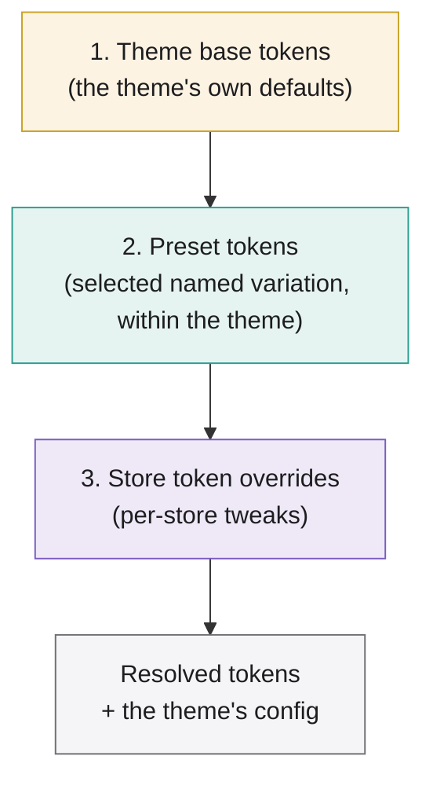
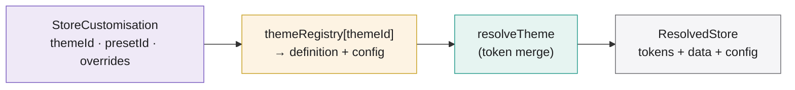
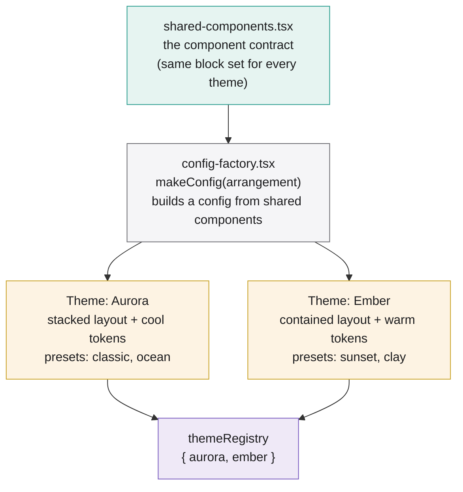

# ARC-17 Theme & Preset System

## Overview

How the theme and preset system works and how it is structured, for the engineering team. Grounded in the implemented prototype (store-kit + admin + storefront). Every type and function below matches the working source.

---

## Concepts: theme vs preset

Two layers, distinct scope.

A **theme** is a whole template family: its own structural layout (the root arrangement), its own Puck config (which components, which slots, what `allow` rules), and its own base token palette. Switching theme can change the page structure itself. In the prototype: `aurora` (stacked, full-bleed layout, cool palette) and `ember` (contained max-width layout, warm palette).

A **preset** is a named set of token values *within one theme*. It changes only look (colours, radii, fonts), never structure or components. Presets are nested inside a theme: `aurora` has `classic` and `ocean`; `ember` has `sunset` and `clay`. A preset is meaningless without its parent theme.

The distinction in one line: **theme changes the skeleton and the skin; preset only changes the skin.**

|  | Theme | Preset |
| --- | --- | --- |
| Changes layout / structure | Yes (own config + root render) | No |
| Changes which components / slots | Yes (own arrangement) | No |
| Changes tokens (colour, radius, font) | Yes (base tokens) | Yes (overrides) |
| Scope | top-level, in the registry | nested inside one theme |
| Field in `StoreCustomisation` | `themeId` | `presetId` |
| Safe to switch on an existing page | Only via shared component contract | Always (same structure) |

---

## How they work together

A store's final appearance is resolved by layering, later winning:



The mental model:

```
themeId    → picks the STRUCTURE + base palette   (aurora stacked vs ember contained)
  presetId → picks a token FLAVOUR within it       (classic vs ocean, inside aurora)
    tokenOverrides → final per-store token tweaks    (this store's brand = purple)
```

**Worked example** (verified output). Store C = `{ themeId: "ember", presetId: "sunset", tokenOverrides: { "--color-brand": "#7c3aed" } }`:

```
1. Ember base:      brand #ff6b35, radius 22px     + Ember contained layout
2. Sunset preset:   brand #ff3b30, radius 24px     ← overrides base
3. Store override:  brand #7c3aed                  ← overrides preset (wins)
─────────────────────────────────────────────────────────────
Result: brand #7c3aed (store won), radius 24px (from preset), Ember contained layout
```

Note the store override beat the preset's brand, while the preset's radius survived because the override was partial. That is exactly the spread-merge order in `resolveTheme`.

---

## Data model

Three types define the system. These are the contract.

```tsx
// A store's saved customisation (mutable, per tenant).
type StoreCustomisation = {
  themeId?: string;                    // which theme; omitted = default
  presetId?: string;                   // which preset within that theme
  tokenOverrides?: Partial<ThemeTokens>; // final per-store token tweaks
};

// A preset: a named token variation shipped inside a theme.
type Preset = {
  id: string;
  name: string;
  tokens: Partial<ThemeTokens>;        // only the tokens it changes
  defaultLayout?: Data;                // optional default page structure
};

// A theme definition: base tokens + its presets (immutable, versioned).
type ThemeDefinition = {
  id: string;
  version: string;
  baseTokens: ThemeTokens;             // full palette (fallback before any preset)
  presets: Preset[];
};

// A full theme = definition (tokens/presets) + config (arrangement).
type Theme = {
  definition: ThemeDefinition;
  config: Config<Components, RootProps>;
};
```

`ThemeTokens` keys are the CSS custom property names (`--color-brand`, `--radius-card`, `--font-display`, …), so resolved values map straight to CSS variables.

---

## Resolution

Two functions do the work. `resolveTheme` merges tokens for a chosen theme; `resolveStore` sits on top and picks the theme from the registry first.

```tsx
// theme/resolve.ts — the token merge (theme → preset → overrides)
export function resolveTheme(
  theme: ThemeDefinition,
  store: StoreCustomisation,
  pageData: Data | null,
): ResolvedTheme {
  const preset = store.presetId
    ? theme.presets.find((p) => p.id === store.presetId)
    : undefined;

  const tokens: ThemeTokens = {
    ...theme.baseTokens,             // 1. theme defaults
    ...(preset?.tokens ?? {}),       // 2. preset
    ...(store.tokenOverrides ?? {}), // 3. store overrides
  };

  const data: Data =
    pageData ?? preset?.defaultLayout ?? { content: [], root: {} };
  return { tokens, data };
}
```

```tsx
// themes/index.tsx — pick theme from registry, then merge, return its config too
export function resolveStore(
  customisation: StoreCustomisation,
  pageData: Data | null,
): ResolvedStore {
  const themeId = customisation.themeId ?? DEFAULT_THEME_ID;
  const theme = themeRegistry[themeId] ?? themeRegistry[DEFAULT_THEME_ID];
  const { tokens, data } = resolveTheme(theme.definition, customisation, pageData);
  return { tokens, data, config: theme.config, themeId };
}
```

`resolveStore` is the single entry point both apps call. It returns resolved `tokens`, resolved page `data`, and the selected theme's `config` (needed because the config, i.e. the arrangement, is theme-specific).



---

## 5. How tokens reach the DOM

Resolved tokens are injected as CSS variables; they are not compiled in. `tokensToStyle` prefixes each token key with `--t-`:

```tsx
tokensToStyle({ "--color-brand": "#7c3aed" })  // → { "--t-color-brand": "#7c3aed" }
```

`theme.css` reads each token from its `--t-*` runtime variable with a static fallback:

```css
@theme inline {
  --color-brand: var(--t-color-brand, #0071e3);
  --radius-card: var(--t-radius-card, 18px);
  /* … */
}
```

An app injects the resolved `--t-*` values on a wrapper element, and the whole subtree restyles. No CSS rebuild, no per-store stylesheet:

```tsx
const style = tokensToStyle(tokens);            // --t-* CSS variables
<div style={style}><Render config={config} data={data} /></div>
```

This is why customisation is pure data: changing a token value changes a CSS variable at runtime.

---

## Multi-theme structure (shared component contract)

Multiple themes share **one component library** (Model 1). Themes differ in arrangement, not in which components exist, so a page built under one theme stays valid under another. Structure:



- **`shared-components.tsx`** defines the block set once: fields, defaults, render. This is the contract, identical across themes.
- **`config-factory.tsx`** exposes `makeConfig(arrangement)`, which builds a full Puck config from the shared components plus a theme's own arrangement (root layout + slot `allow` rules).
- **Each theme** calls `makeConfig` with its arrangement and pairs the result with its `ThemeDefinition` (tokens + presets).
- **`themeRegistry`** collects all themes by id; `resolveStore` looks them up here.

Because the component set is shared, switching a store's `themeId` never orphans a page's blocks, they exist under every theme. Switching preset is trivially safe (same structure); switching theme is safe because of the shared contract.

---

## File structure

```
packages/store-kit/src/
  theme/
    types.ts            ThemeTokens, Preset, StoreCustomisation, ThemeDefinition
    resolve.ts          resolveTheme (token merge) + tokensToStyle
    index.ts            barrel: exports the theme layer  → "@…/store-kit/theme"
  themes/
    shared-components.tsx  the shared component contract (Model 1)
    config-factory.tsx     makeConfig(arrangement) → a theme's config
    index.tsx              the two themes, themeRegistry, resolveStore, DEFAULT_THEME_ID
    demo-stores.ts         hardcoded per-tenant customisations (stand-in for the backend)
  theme.css             tokens read --t-* runtime variables with fallbacks
```

Two export entry points:

- `@…/store-kit/theme`, the primitives: types, `resolveTheme`, `tokensToStyle`.
- `@…/store-kit/themes`, the registry layer: `resolveStore`, `themeRegistry`, `demoStores`, the themes.

Both apps import from `@…/store-kit/themes` and call `resolveStore`.

---

## How the apps use it

Both the admin and the storefront converge on `resolveStore`, so the same store id resolves identically in both.

**Storefront** (server): resolve the store, inject tokens, render with the theme's config.

```tsx
const { tokens, data, config } = resolveStore(customisation, pageData);
// <div style={tokensToStyle(tokens)}><Render config={config} data={data} /></div>
```

**Admin** (editor): resolve for the store being edited, inject tokens on the `<Puck>` wrapper for a live-themed canvas. `iframe={{ enabled: false }}` is required, CSS variables do not cross an iframe boundary.

```tsx
const { tokens, config } = resolveStore(customisation, null);
// <div style={tokensToStyle(tokens)}>
//   <Puck config={config} data={data} iframe={{ enabled: false }} />
// </div>
```

Switching preset in the admin is always safe. Switching theme changes the `config` too, so the canvas re-arranges, not just re-colours.

---

## Extending the system

- **Add a preset**: append an entry to a theme's `presets` array (id, name, partial tokens). No other change; it appears wherever that theme's presets are listed.
- **Add a theme**: call `makeConfig` with a new arrangement, pair it with a new `ThemeDefinition`, register it in `themeRegistry`. It shares the component contract automatically.
- **Add a token**: add the key to `ThemeTokens`, add a `-t-*` line to `theme.css`, set it in each theme's `baseTokens`.
- **Add a customisable component**: add it to `shared-components.tsx`; every theme gains it, and each theme's `makeConfig` arrangement decides which slots may use it.

---

## Summary

- **Theme** = structure + config + base palette (top-level, `themeId`). **Preset** = token variation within a theme (nested, `presetId`). **Overrides** = final per-store token tweaks.
- They combine by a layered merge: **theme base → preset → overrides**, later winning, in `resolveTheme`.
- `resolveStore` is the single entry point: pick theme from the registry, merge, return tokens + data + the theme's config.
- Tokens reach the DOM as `-t-*` CSS variables read by `theme.css`, so customisation is runtime data, not a rebuild.
- Multiple themes share one component contract (Model 1), so pages stay valid across themes; presets are always safe to switch, themes are safe because of the shared contract.